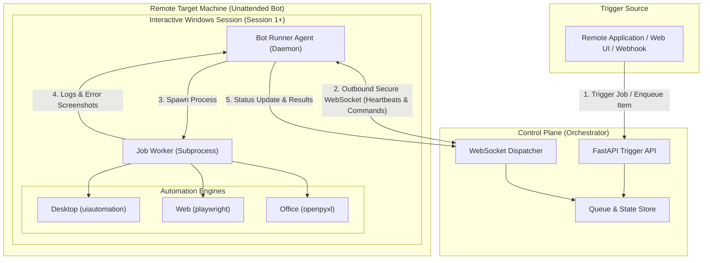

# OS RPA Tool - Unattended Architecture & Remote Trigger Design

## 1. System Overview

To run this tool in **unattended mode** on remote machines triggered from a remote application (e.g. ERP, Web Portal, CI/CD, or Orchestrator), the system separates into two tiers:
1. **Control Plane (Orchestrator)**: Manages triggers, queues, and bot availability.
2. **Execution Plane (Remote Bot Host)**: Runs a background agent inside an active interactive Windows desktop session, executing UI actions (`uiautomation`, `playwright`, `openpyxl`).

---

## 2. Architecture Diagram

---

## 3. Communication Model: Why Outbound Pull (WebSocket / Queue Polling)?

* **Inbound Push (Direct HTTP to Bot)**: Requires open inbound firewall ports on the bot machine, static IP or VPN, and SSL certificates per host.
* **Outbound Pull (Recommended)**: The Bot Agent initiates an outbound connection (`wss://orchestrator/ws/agent?token=...`).
  - Works through firewalls, NAT, and corporate proxies without inbound port opening.
  - Heartbeats immediately detect when a bot goes offline.
  - Adding more bot machines requires zero firewall changes.

---

## 4. Unattended Windows Execution & Session 0 Isolation

> **Critical Windows Constraint**: Standard Windows Services (`services.msc`) run in **Session 0**, which has no display surface or interactive window station. Desktop automation (`uiautomation`, headed browsers) will fail.

### Configuration for Unattended Execution:
1. **Dedicated Service Account**: Dedicated local or domain user (e.g., `svc-rpa-runner`).
2. **Windows Auto-Logon**: Configured via Microsoft Sysinternals `Autologon` to automatically log into the user profile on boot.
3. **Interactive Launch via Task Scheduler**:
   - Trigger: "At log on of `svc-rpa-runner`".
   - Settings: "Run only when user is logged on" (guarantees execution in interactive Session 1+).
4. **Prevent Lock Screen**: Set Windows power plan to never sleep/display off, disable lock screen.
5. **RDP Disconnection Handling**: Use `tscon %sessionname% /dest:console` when disconnecting from remote desktop to prevent session locking.

---

## 5. Execution Sandboxing & Telemetry

* **Process Isolation**: The Agent daemon runs `worker.py` in a separate `subprocess.Popen` per job. A crash or memory leak in an automation script never terminates the runner agent.
* **Watchdog & Timeout**: Hard timeout enforcement terminates runaway scripts.
* **Failure Forensics**: On unhandled exceptions, the worker automatically takes a full desktop screenshot and transmits it alongside the Python traceback back to the Orchestrator.

